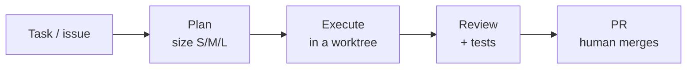

## 01 · Overview
_Agents speed up the work; humans own decisions, merges and releases._

Read before any task: `PRD.md` (what) → `ARCHITECTURE.md` (where) → `CODE_STYLE.md` (how) → `TESTING.md` (proof). Project rules in `<CLAUDE.md / AGENTS.md at repo root>` win when they disagree with this file.

## 02 · Agent Roles
_Who does what, with which tools, triggered when._

| Agent | Purpose | Tools | Trigger |
|---|---|---|---|
| Scout | Find files, call sites, configs (read-only) | Read, Grep, Glob | before any change |
| Implementer | Small, well-scoped changes | Edit, Write, test runner | approach decided |
| Test writer | Tests that fail when behavior breaks | Edit, test runner | new/changed logic |
| Reviewer | Review diff against these docs | Read, git diff | once per PR |
| Security auditor | Auth, scoping, secrets, webhooks | Read, git diff | diff touches `SECURITY.md` areas |

## 03 · Agent Workflow
_Every task follows the same loop._



## 04 · Example Task
_A good request to an agent._

```text
Task: add CSV export to the invoices list.
Context: PRD.md §06 (feature "Export"), ARCHITECTURE.md §04, DESIGN_SYSTEM.md §06 (Button).
Requirements:
- server-side export, scoped to the current tenant
- follow CODE_STYLE.md patterns; tests per TESTING.md §04
Done when: tests green, reviewer passed, PR opened against <integration branch>.
```

## 05 · Tools & Integrations
_What agents may use, and with which permissions._

| Tool | Allowed for | Notes |
|---|---|---|
| Shell | tests, lint, build, git read | no deploys, no force-push |
| GitHub | branches, PRs, issues | never merge without a human |
| <MCP / external APIs> | <…> | <read-only? sandbox?> |

## 06 · Best Practices
_How to get good results._

- [ ] Give the doc section, not the whole repo, as context
- [ ] State "done when" before starting; verify with a command, not a re-read
- [ ] One task = one branch = one PR
- [ ] Ask when a requirement is ambiguous; never guess silently

## 07 · Safety & Limits
_Lines agents never cross._

- Never touch production data or secrets; never print secrets anywhere
- Never deploy, merge, push to protected branches, or delete data without explicit human approval
- Never skip, comment out or weaken tests to make CI pass (`TESTING.md` §07)
- Changes to auth, payments, data scoping and CI require the security review

## 08 · Keeping Docs Current
_These 8 docs are the agents' context. Stale docs produce wrong code._

| Change in code | Update |
|---|---|
| New feature / scope change | `PRD.md` |
| New token or component | `DESIGN_SYSTEM.md` |
| New service, dependency or boundary | `ARCHITECTURE.md` |
| New table/field/index | `DATABASE.md` |
| New role, route or secret | `SECURITY.md` |
| New pattern or convention | `CODE_STYLE.md` |
| New test layer, lane or gate | `TESTING.md` |
