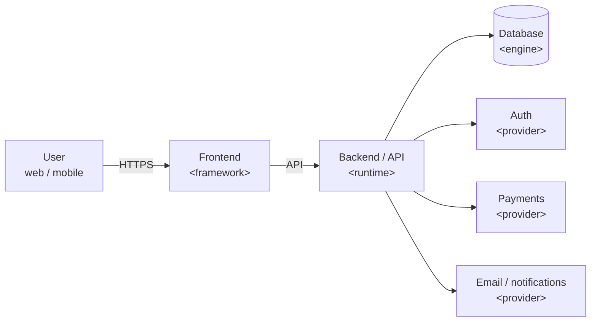

## 01 · System Overview
_The containers and the arrows between them. Update this diagram when a box or arrow changes._



## 02 · Tech Stack
_Every layer, the choice, and why._

| Layer | Choice | Version | Why this |
|---|---|---|---|
| Frontend | <…> | <x.y> | <one line> |
| Backend | <…> | <x.y> | <…> |
| Database | <…> | <x.y> | <…> |
| Auth | <…> | — | <…> |
| Hosting / deploy | <…> | — | <…> |
| Monitoring | <…> | — | <…> |

## 03 · Project Structure
_Where things live. One line per top-level folder._

```text
<repo>/
├── <app or src>/      # <what lives here>
├── <components>/      # <…>
├── <lib or services>/ # <…>
├── <tests>/           # <…>
└── docs/              # these 8 documents
```

## 04 · Data Flow
_One representative request, end to end._

1. <User action> on <screen>
2. Frontend calls `<METHOD /path>`
3. Backend checks <auth / scope>, then <business step>
4. <Store / queue / external call>
5. Response returns <shape>; UI shows <state>

## 05 · Boundaries & Rules
_Which part may call which. Breaking these needs a decision below._

- <Layer A> never imports <Layer B>
- All data access goes through <service/repository>
- External calls only from <module>, with timeout <n>s and retry <rule>

## 06 · Environments
_Where the code runs and how it gets there._

| Env | URL | Deploys from | Data |
|---|---|---|---|
| Local | `localhost:<port>` | working tree | seed / fixtures |
| Dev / staging | <url> | `<branch>` | test data |
| Production | <url> | `<branch / tag>` | real users |

## 07 · Scalability & Future
_Known limits and the next step when we hit them._

| Limit | Signal to watch | Next step |
|---|---|---|
| <e.g. DB connections> | <metric / threshold> | <pooling / read replica …> |

## 08 · Architecture Decisions
_One line per decision; long ones link to an ADR._

| Date | Decision | Reason | Link |
|---|---|---|---|
| <YYYY-MM-DD> | <chose X over Y> | <why> | <ADR / PR> |
