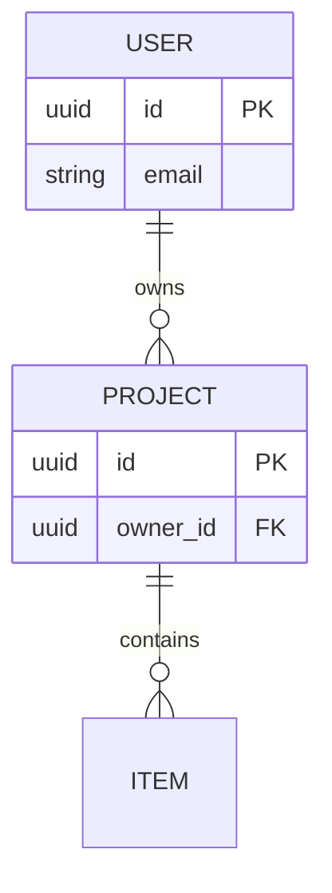

## 01 · Overview
_Engine, hosting and the shape of the data._

| Field | Value |
|---|---|
| Engine | <Postgres · MySQL · Firestore · …> + version |
| Hosting | <provider / region> |
| Multi-tenancy | <none · column per row (`tenant_id`) · DB per tenant> |
| Migrations | <tool> — `<command>` |

## 02 · Entity Relationship Diagram
_Core entities only. Regenerate or edit when a table/collection is added._

## 03 · Entities
_One row per table/collection._

| Entity | Purpose | Owner / scope field | Key fields | Growth |
|---|---|---|---|---|
| `<users>` | <…> | — | `id`, `email` | <rows/day> |
| `<projects>` | <…> | `owner_id` | <…> | <…> |

## 04 · Data Ownership & Scoping
_Which field decides who may read a row, and where that check happens._

- Every row of `<entity>` carries `<scope field>`, set on create, **never changed**
- Scope comes from <session / token>, never from client input
- Enforced in <service layer / security rules / RLS policy>

## 05 · Indexes & Query Patterns
_Every hot query, the index that serves it, and its cost._

| Query | Index | Expected rows | Calls/day |
|---|---|---|---|
| <list items of a project, newest first> | `(project_id, created_at desc)` | ≤ <n> | <n> |

## 06 · Migrations
_How schema changes ship without downtime._

- Additive first: add column/field → backfill → switch reads → remove old (separate releases)
- Every migration: reversible or has a written rollback; long backfills run in batches with `--dry-run`
- <Tenant-wide migrations: how long they take, how they are run>

## 07 · Sensitive Data
_Personal and secret data, and how it is protected._

| Field | Class | Protection | Retention |
|---|---|---|---|
| `<email>` | PII | <encrypted at rest / masked in logs> | <period> |
| `<token>` | secret | <hashed / never logged> | <…> |

## 08 · Backup & Recovery
_What happens on the bad day._

- Backups: <frequency>, kept <period>, restore tested <date>
- RPO <minutes> · RTO <minutes>
- Restore runbook: <link>
