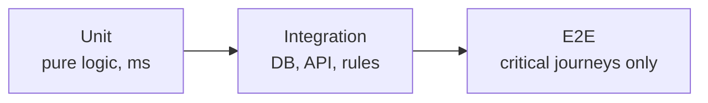

## 01 · Strategy
_Test behavior that can break, at the lowest layer that proves it._

A test earns its place only if it fails when the behavior breaks. No tests that cannot fail.

## 02 · Layers & Tools
_Which tool, where tests live, and how fast each layer must be._

| Layer | Tool | Location | Budget |
|---|---|---|---|
| Unit | <Vitest / PHPUnit / pytest> | `<path>` | < <n> s total |
| Integration | <tool + real DB / emulator> | `<path>` | < <n> min |
| E2E | <Playwright / Cypress> | `<path>` | < <n> min |

## 03 · Running Tests
_Copy-paste commands._

| What | Command |
|---|---|
| Everything | `<cmd>` |
| One file | `<cmd> <path>` |
| Related to my changes | `<cmd --changed / related>` |
| E2E (local) | `<cmd>` — needs <server / seed / env> |

## 04 · What Must Be Tested
_Non-negotiable coverage. Each line maps to a test file._

- [ ] <Auth: role X cannot do Y> — `<test file>`
- [ ] <Money: totals, rounding, currency> — `<…>`
- [ ] <Tenant/data isolation> — `<…>`
- [ ] <Each critical journey from PRD.md §05> — `<…>`

## 05 · Test Data
_Fixtures, factories and seed data._

- Factories in `<path>`; build objects through them, not by hand
- Seed data: `<command>`; never real customer data
- External services: <mocked at HTTP boundary / sandbox accounts>

## 06 · CI Lanes
_What runs on which event. The full suite always runs before release._

| Lane | Runs when | Paths that trigger it | Blocks merge |
|---|---|---|---|
| fast (lint, types, unit) | every PR | `**` | yes |
| <backend integration> | PR touches | `<globs>` | yes |
| <e2e> | <ready-for-review / label / merge queue> | `<globs>` | <yes/no> |
| full suite | nightly + release | — | release |

## 07 · When a Test Fails
_Investigate; never silence._

1. Reproduce locally with the single failing test
2. Decide which is wrong — code or test — and say why, with evidence
3. Fix the code, or update the test to a contract that legitimately changed (link where)
4. Never skip, comment out, loosen assertions or add retries without explicit approval and a tracking issue
5. Flaky → quarantine lane with an issue and an expiry date, not a retry loop

## 08 · Quality Gates
_Numbers CI enforces._

| Gate | Threshold | Where |
|---|---|---|
| Coverage of changed lines | <n>% | CI |
| Mutation score (changed files) | <n>% (optional) | CI / weekly |
| CI wall time per PR | < <n> min | measured monthly |
